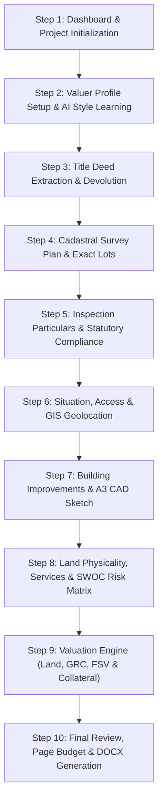

# Chartered Valuation Report Creation Workflow Guide

> [!NOTE]
> This document specifies every step in the Property Valuer Pro valuation pipeline, from initial valuer credential configuration to final Microsoft Word (.docx) chartered report compilation and export.

---

## Architecture Overview

---

## Detailed Step-by-Step Report Creation Pipeline

### Step 1: Dashboard & Project Setup
- **Screen:** `DashboardScreen` (`/` or `/step1`)
- **Key Actions:**
  - Create a new valuation case file by entering Project Name, Client / Financial Institution, and Branch.
  - Review saved active and completed valuation projects.
  - Monitor monthly free report quota counter (e.g. 0/10 Free Tier generations).

---

### Step 2: Valuer Profile Setup & AI Style Learning
- **Screen:** `ProfileScreen` (`/step2`)
- **Workflow & Rules:**
  1. **Professional Credentials:**
     - Valuer Name, Qualifications, Registration Number, Professional Membership.
  2. **Chambers & Contact Details:**
     - Office Address, Primary Phone, Secondary Phone, Email, Bank Valuation Panels.
  3. **Multi-Document Upload & Gemini Style Extraction:**
     - Select and upload multiple sample Word (.docx) or PDF draft reports.
     - Gemini AI analyzes uploaded reports for layout conventions, table formats, and letterhead styles.
     - Stores the extracted **AI Style Blueprint** to guide subsequent report compilation.
  4. **Persistence & Draft Management:**
     - Details are saved permanently once; never need re-entry upon reopening.
     - Can edit, add, or remove details at any time.
     - Tapping **[Save & Next to Deed]** automatically creates an editable profile draft and proceeds directly to Title Deed Extraction.

---

### Step 3: Title Deed Extraction & Devolution of Title
- **Screen:** `DeedExtractionScreen` (`/step3`)
- **Workflow & Rules:**
  1. **Document Ingestion:** Upload PDF or high-resolution camera photograph of Deed of Transfer.
  2. **Gemini Multimodal OCR Extraction:**
     - Deed Number, Execution Date, Notary Public Name, Station.
     - Land Registry office, Day Book Number, Registration Volume & Folio.
     - Current Vendee (Purchaser) Name, NIC, Address.
     - Vendor (Seller) Name, Prior Consideration Amount (LKR).
  3. **Chartered Verification:** Valuer reviews and verifies extracted fields before proceeding.

---

### Step 4: Cadastral Survey Plan Particulars & Exact Lot Selector
- **Screen:** `PlanExtractionScreen` (`/step4`)
- **Workflow & Rules:**
  1. **Survey Plan Ingestion:** Upload Cadastral Survey Plan image or PDF.
  2. **AI Extraction:**
     - Plan Number, Survey Date, Licensed Surveyor Name, Surveyor Reg Number.
     - Land / Estate Name, Village, Local Authority Limits.
  3. **Lot Identification & Exact Boundaries:**
     - Discovers individual allotments with Acres, Roods, Perches (A-R-P) and decimal total perches.
     - Physical Cardinal Boundaries: North, East, South, West.
     - Multi-lot selector allowing appraisal of single lots or combined cadastral parcels.

---

### Step 5: Purpose of Valuation & Site Inspection
- **Screen:** `InspectionScreen` (`/step5`)
- **Workflow & Rules:**
  1. **Appraisal Purpose:** Credit collateral / mortgage underwriting, probate, balance sheet, or forced sale.
  2. **Inspection Particulars:** Inspection Date, Weather Conditions, Presence of borrower/representatives.
  3. **Administrative & Statutory Compliance:**
     - Local Authority (Municipal / Urban Council / Pradeshiya Sabha).
     - Planning & Building conformity: Street lines, Building limits, Railway/Canal reservations.

---

### Step 6: Situation, Accessibility & GIS Geolocation
- **Screen:** `LocationScreen` (`/step6`)
- **Workflow & Rules:**
  1. **Geographic Localization:** GPS Coordinates (Latitude, Longitude) pin on satellite map.
  2. **Locality Description:** Distance from nearest town center (km), Prominent landmarks.
  3. **Access Road Parameters:**
     - Frontage road width (feet), Road surface (asphalt / concrete / gravel).
     - Motorable accessibility (40ft container / heavy vehicle / passenger car / pedestrian only).
     - Infrastructure utilities: CEB 3-Phase Electricity, NWSDB Pipe-Borne Water, Telecom, Drainage.

---

### Step 7: Building Improvements & Lightweight CAD Sketcher
- **Screen:** `BuildingDetailsScreen` (`/step8`) & `A3SketchingScreen` (`/step7`)
- **Workflow & Rules:**
  1. **Structural Classification:** Bare land vs Improved property.
  2. **Building Specifications (if improved):**
     - Ground Floor & Upper Floor Area (sq.ft.), Approximate Age (years), Structural Condition.
     - Architectural finishes: Roof structure, Ceiling, Walls, Floors, Doors & Windows, Bath Fittings.
     - Accommodation breakdown: Living, Dining, Bedrooms, Pantries, Attached Washrooms, Garage.
  3. **Photo Register:** Upload tagged site photos (Front Elevation, Side View, Interior, Access Road).
  4. **CAD Floor Plan / Boundary Sketch:** Interactive canvas to sketch boundary perimeters, room dimensions, and setback lines.

---

### Step 8: Physical Characteristics & SWOC Risk Matrix
- **Screen:** `ValuationScreen` / Land & SWOC tab
- **Workflow & Rules:**
  1. **Land Topography & Subsoil:** Level, undulating, sloping, rock outcrops, water table.
  2. **SWOC Analysis:**
     - **Strengths (S):** Proximity to highway, high residential demand, clear title.
     - **Weaknesses (W):** Narrow access bend, irregular plot shape.
     - **Opportunities (O):** Expanding commercial zone, rapid capital appreciation.
     - **Constraints (C):** High seasonal rainfall, statutory building setbacks.

---

### Step 9: Chartered Valuation Engine & Calculations
- **Screen:** `ValuationScreen` (`/step9`)
- **Mathematical Formulations (conforming strictly to SKILL.md):**
  1. **Land Value:**
     $$\text{Land Value} = \text{Evaluated Extent (Perches)} \times \text{Adopted Market Rate Per Perch}$$
  2. **Gross Replacement Cost (GRC):**
     $$\text{GRC} = \text{Total Floor Area (sq.ft.)} \times \text{Building Replacement Cost Rate / sq.ft.}$$
  3. **Depreciation Allowance:**
     $$\text{Depreciation} = \text{GRC} \times \left(\frac{\text{Depreciation Percentage}}{100}\right)$$
  4. **Depreciated Building Value:**
     $$\text{Net Structural Value} = \text{GRC} - \text{Depreciation}$$
  5. **Total Real Estate Worth:**
     $$\text{Raw Market Value} = \text{Land Value} + \text{Depreciated Building Value}$$
  6. **Certified Market Value (Say):**
     $$\text{Market Value (Say)} = \text{Rounded to nearest standard valuation increment (LKR 25,000 / 50,000 / 100,000)}$$
  7. **Forced Sale Value (FSV):**
     $$\text{FSV} = \text{Market Value (Say)} \times \left(\frac{\text{FSV Percentage (typically 70\% - 80\%)}}{100}\right)$$
  8. **Collateral Risk Underwriting Rating:** Good / Fair / Low / High Risk.

---

### Step 10: Final Review, Page Budget & DOCX Generation
- **Screens:** `FinalReviewScreen` (`/step10`) & `GenerationSuccessScreen` (`/step10_success`)
- **Workflow & Rules:**
  1. **Chartered 10-Point Audit:** Comprehensive verification checklist validating all sections.
  2. **Page Budget Optimization:** Target 3, 5, or 8-page budget distribution.
  3. **Direct OpenXML (.docx) Synthesis:**
     - Generated natively on Android using `DocxService` without external servers or cloud dependencies.
     - Includes Valuer Letterhead, Executive Appraisal Summary Table, 10 Numbered Valuation Sections, Annexure I (Title Schedule), Annexure II (SWOC Analysis), and Annexure III (Photo Register).
  4. **Export & Sharing:** Immediate opening in Microsoft Word or Google Docs, and one-tap Android sharing.
